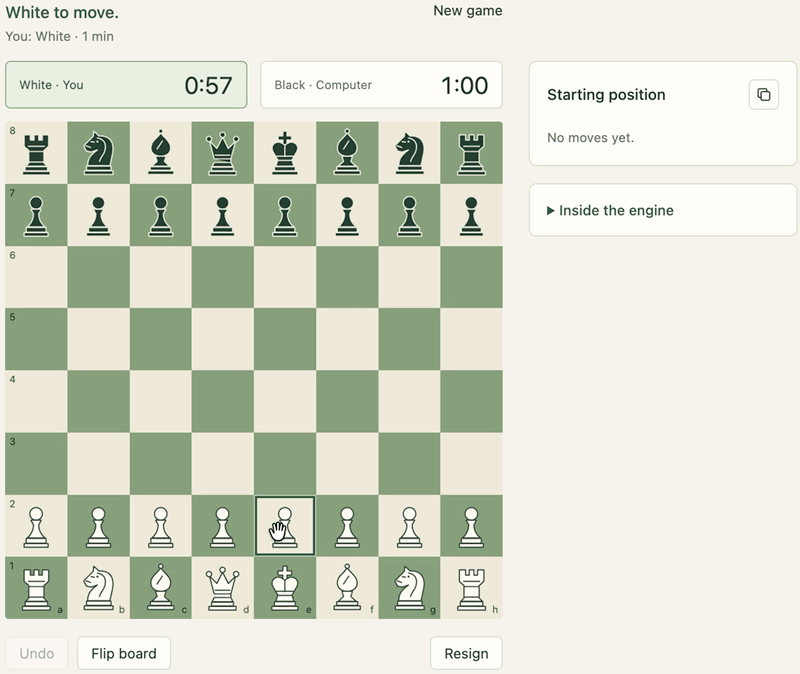

  

# Chess AI

A dependency-free Rust chess program with a local browser interface.

- Play against the computer, share a board on one device, invite an opponent over a LAN, or watch AI vs. AI.
- Choose timed games with increments or unlimited games with a configurable AI thinking time.
- Move pieces by clicking, dragging, or using the keyboard, and queue premoves against the computer.
- View move history, opening names, and live engine statistics, including evaluation, search depth, nodes, and cache usage. Copy games as PGN.
- Runs on macOS, Windows, and Linux using Rust 1.70 or newer, the standard library, and bundled browser assets. No crates, frontend packages, accounts, or external services; gameplay works offline.

## Run

Run `make`, or use the launcher for your platform:

- **macOS:** double-click `mac_launcher.command`.
- **Windows:** double-click `windows_launcher.cmd`.
- **Linux:** run `sh linux_launcher.sh`.

## Engine

- **Search:** iterative-deepening negamax with Principal Variation Search, an optimization of alpha-beta pruning. Quiescence search extends tactical positions; cached moves, captures, killers, and history guide move ordering.
- **Evaluation:** material and positional scoring blended between middlegame and endgame, including mobility, pawn structure, central space, threats, and king safety.
- **Caching:** incremental 64-bit Zobrist hashing and a shared transposition table reuse search results, with full-key, repetition-history, and halfmove-clock checks. Cache storage grows on demand to a fixed **100,000,000-byte ceiling**; other process memory is additional.
- **Parallelism:** deeper searches share work across threads, using `max(1, floor(0.75 × logical CPUs))`, capped at 64 threads. On a single logical CPU, brief pauses target roughly 10% idle time.
- **Time management:** search follows the available time budget and returns the last fully completed iteration. In solo play, the engine also ponders during your turn and retains cached work for its reply.
- **Rules:** Rust handles legal moves, clocks, undo, checkmate, stalemate, insufficient material, repetition, and the fifty-move rule.
- **Measurements:** [benchmark studies](benchmarks/) document evaluation changes, search optimizations, performance, and limitations, including archived experiments.

## Verify

- Formatting: `cargo fmt -- --check`
- Rust tests: `cargo test --offline`
- Lint: `cargo clippy --all-targets --offline -- -D warnings`
- Release build: `cargo build --release --offline`
- HTTP smoke test: `python3 tests/http_smoke.py` (build release first; requires a local socket).
- UI smoke test: `node tests/ui_smoke.cjs` (simulated DOM/audio; visual changes also need browser testing).
